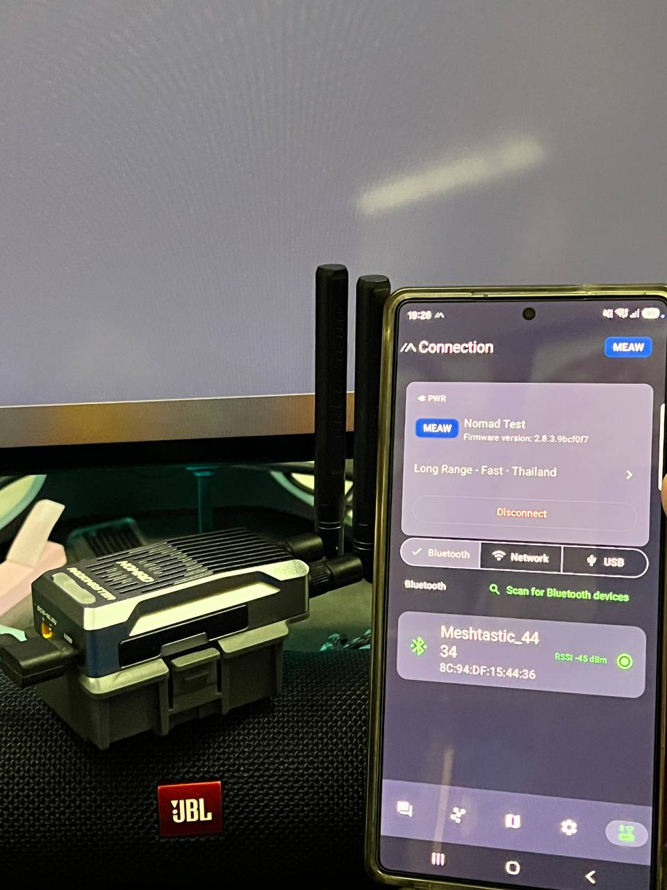

# Nomad × Meshtastic

**One handheld. Two LR1121 radios. One mesh that does not have to pick a single personality.**



RadioMaster Nomad was born as an ExpressLRS radio. This tree turns the main ESP32 into an experimental **dual-radio Meshtastic node**: Radio A and Radio B on independent LoRa / LoRa 2.4 / FSK front-ends, with a local RF gate, a cooling fan, and a two-pixel status light.

This is bring-up firmware. It boots. Both radios initialize. USB and BLE talk. The interesting work - true dual-channel operation the phone app can actually use - is still ahead.

---

## Why this exists

Meshtastic today is a **one-modem** protocol and a **one-modem** app. Nomad has **two LR1121s**. That is a different machine.

The long-term shape:

| Radio | Role (example) |
| --- | --- |
| A | `LONG_FAST` - range, slow, the neighborhood backbone |
| B | `SHORT_TURBO` (or another modem preset) - nearby, snappy, high rate |

A node like that can listen on two meshes at once, originate on a chosen radio, and keep ACK affinity on the radio that heard the peer. The firmware in this repo is the first cut of that policy. The stock Meshtastic apps still present a single radio. That is the next mountain.

---

## Hardware

| Piece | Notes |
| --- | --- |
| MCU | ESP32-PICO-D4, 4 MB flash |
| Radios | Dual Semtech **LR1121** |
| Default presets (this build) | A = `LONG_FAST`, B = `MEDIUM_FAST` |
| User button | GPIO14 - stock Meshtastic button |
| Aux button | GPIO12 - short: fan AUTO → ON → OFF; hold 3 s: local RF gate |
| Fan | GPIO2 - spins before a permitted TX, 60 s after TX; cooling overrides manual OFF |
| RGB | GPIO22, two pixels - A / B activity, blue blink while BLE pairing |
| BLE name | `Meshtastic_4434` (device-derived suffix) |
| Pairing PIN | **123456** (fixed; Nomad has no screen) |
| C3 backpack | Present on the board; **not** a Meshtastic transport and **not** flashed by the installer |

---

## What already works

- Dual LR1121 bring-up on `radiomaster-nomad` (`2.8.3.9bcf0f7` tree)
- USB Meshtastic protobuf API
- BLE advertising, pairing, and phone connection
- Fan policy and RGB activity / pairing indication
- Local RF inhibit until a measured PA table exists
- Native policy tests for origin, ACK affinity, RX flood, wrap, and RF gate
- Windows installer that backs up the **entire** 4 MB main flash before any write

## What is still honest about being unfinished

- **RF TX is inhibited.** There is no shipped conducted-power calibration table. Region stays `UNSET` until you set a legal country.
- Simultaneous two-network RX/TX, ACK exchanges, and PDR have not been measured on a bench.
- Optical LED and fan behavior are implemented; treat physical confirmation as still in progress.
- Stock Meshtastic Android / iOS / Web still look like a **single** radio.

Do not transmit at 30 dBm, or at all, until you have a region, a calibration, and a legal allocation.

---

## Roadmap

### 1. Dual-channel Meshtastic app

Nomad can sit on **LongFast + ShortTurbo** (or any two presets) at the same time. The current apps cannot express that.

Needed in the clients:

- Two live modem views (channels, SNR/RSSI, utilization) instead of one
- Explicit **TX radio** / **TX preset** when composing a message
- Inbox tagged by which radio received the packet
- Config UI for radio A vs radio B (preset, frequency slot, hop limit)
- Protobuf / API extensions so USB, BLE, and HTTP expose dual radio state

Until that lands, the device is a dual-radio *node* driven by a single-radio *remote*.

### 2. Dual-channel firmware

The `NomadDualRadio` path already owns two radios and a policy layer. Next firmware work:

- First-class dual preset config (not just compiled defaults)
- Per-radio channel / modem settings that survive reboot
- Cleaner TX selection: user intent, role, and ACK affinity
- Measured PA / APC2 calibration and a safe unlock path for TX
- Region and duty-cycle handling that is sane with two live modems
- C3 backpack: leave it alone, or give it a documented job

### 3. Other optimization

- RX concurrency and IRQ latency on two LR1121s
- Power: fan AUTO, BLE, and idle current
- Heat: Nomad can push a lot of RF; firmware should know when to refuse
- Smaller image / RAM on the 4 MB PICO-D4
- Lab vs field builds (`radiomaster-nomad-rf-lab` vs ship)
- Upstream the Nomad target to Meshtastic once the policy is not a science project

---

## Repo layout

```
firmware/                 Meshtastic tree + Nomad target and dual-radio code
variants/.../radiomaster_nomad/
artifacts/radiomaster-nomad/   Flashable images (no ELF objects)
install-nomad.ps1         Backup-first Windows flasher
nomad_calibration.py      PA table helper
NOMAD-IMPLEMENTATION.md   Bring-up evidence and limits
ExpressLRS/  targets/     Hardware context from the original radio
```

Meshtastic firmware is GPL-3.0. Nomad changes in this repository follow that license.

---

## Build

Needs PlatformIO. This tree was built with PlatformIO Core **6.2.1b2** on the ESP32 platform used by Meshtastic 2.8.x.

```powershell
.\.venv\Scripts\pio run -d firmware -e radiomaster-nomad
.\.venv\Scripts\pio run -d firmware -e radiomaster-nomad-rf-lab
.\.venv\Scripts\python -m unittest -v test_nomad_calibration
```

Images land under `firmware/.pio/build/<env>/` and are packaged in `artifacts/<env>/`.

## Flash (Windows)

The installer always selects `--chip esp32`, refuses an undersized or ambiguous image, and **backs up the whole main flash** before it writes. It never flashes the C3.

```powershell
# Backup and reset only
.\install-nomad.ps1 -Port COM3 -Baud 115200

# Backup, then install Nomad Meshtastic
.\install-nomad.ps1 -Port COM3 -Baud 115200 -Install
```

First conversion writes the factory image at `0x0` and LittleFS at `0x300000`. Later app-only updates can write `0x10000` to keep settings.

Use **115200** on this unit. A 460800 backup failed a digest check in bring-up; the installer will stop rather than brick you.

Keep your local `backups/` directory **private**. Original dumps are gitignored on purpose.

## Pairing

1. Boot the Nomad.
2. Connect to **Meshtastic_4434** from the Meshtastic app.
3. PIN: **123456**.
4. Both RGB pixels blink blue while pairing.

GPIO12 is fan / RF gate. It does not enter pairing mode.

---

## Status lights

| Pattern | Meaning |
| --- | --- |
| Green pulse (~150 ms) | Valid RX on that radio |
| Red | TX, bad frame, or radio init fault |
| Blue blink (both pixels) | BLE pairing |
| Off | Idle |

---

## Safety

This is unofficial, experimental firmware for a radio that was not sold as a Meshtastic product. You are the amateur-radio / SRD licensee. Set a region. Measure power. Do not ship a hot PA into an antenna you have not characterized.

RadioMaster, ExpressLRS, and Meshtastic are trademarks of their owners. This project is not affiliated with them.

---

## Credits

- [Meshtastic firmware](https://github.com/meshtastic/firmware) - the stack this forks in-tree
- RadioMaster Nomad hardware
- Bring-up target `radiomaster-nomad` on ESP32-PICO-D4 + dual LR1121
